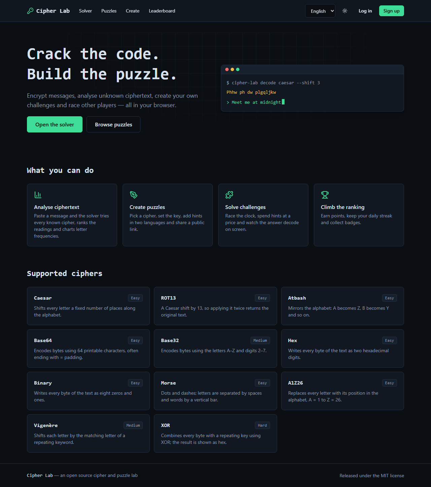
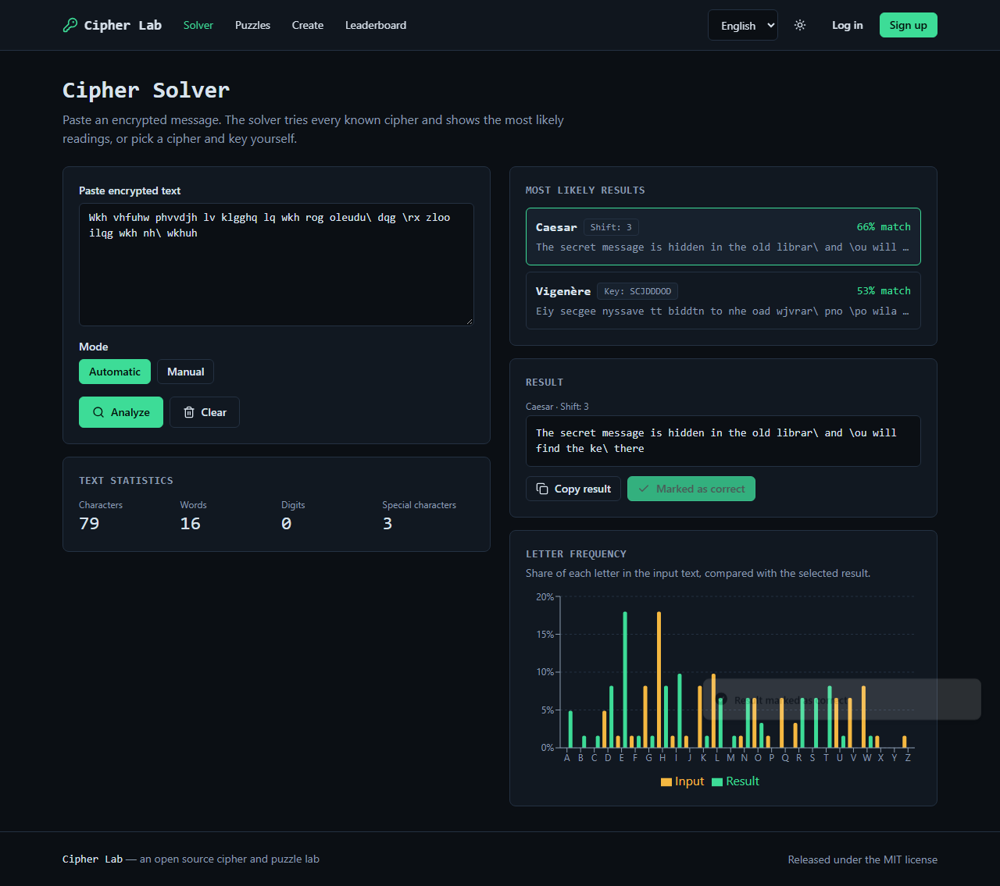
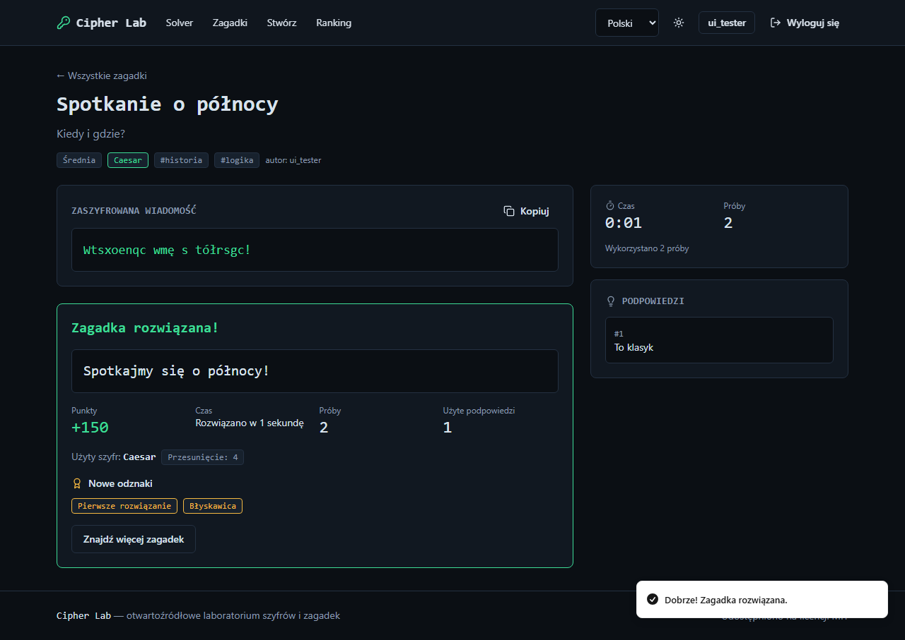

# Cipher Lab

Polski · [English](README.md)

Otwartoźródłowa platforma webowa do **tworzenia, rozwiązywania i udostępniania szyfrów oraz zagadek logicznych**. Szyfruj tekst, analizuj nieznane wiadomości, buduj własne wyzwania i rywalizuj z innymi graczami. Wygląd to połączenie hakerskiego terminala, escape roomu i platformy z puzzlami. Interfejs jest w pełni dostępny po polsku i angielsku.



|                                      Solver                                       |                                  Rozwiązana zagadka                                  |
| :-------------------------------------------------------------------------------: | :----------------------------------------------------------------------------------: |
|  |  |

## Funkcje

- **11 szyfrów:** Caesar, ROT13, Atbash, Base64, Base32, Hex, Binary, Morse, A1Z26, Vigenère i XOR, ze wspólnym interfejsem.
- **Solver (łamacz szyfrów):** wklej szyfrogram, a aplikacja sama sprawdzi wszystkie znane szyfry i uszereguje najbardziej prawdopodobne odczytania. Możesz też ręcznie wybrać szyfr i klucz. Pokazuje statystyki tekstu (znaki, słowa, cyfry, znaki specjalne) i wykres częstotliwości liter.
- **Kreator zagadek:** tytuł, opis, wiadomość, szyfr i klucz, poziom trudności, limit prób, limit czasu, do 3 podpowiedzi i tagi. Każda zagadka dostaje publiczny link. Treść może być po polsku, po angielsku albo w obu językach.
- **Rozwiązywanie:** licznik czasu i prób po stronie serwera, podpowiedzi za punkty karne, animacja dekodowania po rozwiązaniu i wyjaśnienie.
- **Profile i rankingi:** punkty zależne od trudności, dzienne serie, odznaki oraz ranking dzienny, tygodniowy i globalny.
- **Galeria:** wyszukiwanie po tytule i tagach, filtry (trudność, tag, szyfr), sortowanie (najnowsze, najpopularniejsze, najtrudniejsze), paginacja i statystyki zagadek.
- **Dwujęzyczność:** polski i angielski (`next-intl`, domyślnie angielski), język w adresie URL (`/en/solver`, `/pl/solver`), automatyczne wykrywanie przy pierwszej wizycie, `hreflang`, adresy canonical i `sitemap.xml` z obiema wersjami.
- Domyślnie ciemny motyw, opcjonalnie jasny; responsywność i obsługa klawiatury.
- Bez płatnych API i usług chmurowych. Wszystko działa na Twoim komputerze.

## Stos technologiczny

Next.js (App Router) · TypeScript (strict) · Tailwind CSS · Radix UI · Prisma + SQLite · Zod · Framer Motion · Recharts · next-intl · Vitest · ESLint i Prettier · Docker Compose.

## Uruchomienie

### Przez npm

Wymagany Node.js 22 lub nowszy.

```bash
git clone <adres-twojego-forka> cipher-lab
cd cipher-lab
cp .env.example .env          # w Windows: copy .env.example .env
npm install
npm run db:deploy             # tworzy bazę SQLite
npm run db:seed               # opcjonalnie: dodaje kilka przykładowych zagadek
npm run dev
```

Otwórz <http://localhost:3000>. Wersja produkcyjna: `npm run build` i `npm start`.

### Przez Docker Compose

```bash
docker compose up --build
```

Aplikacja działa pod adresem <http://localhost:3000>. Baza danych jest w wolumenie `cipher-lab-data`, a migracje uruchamiają się automatycznie przy starcie. Przy pierwszym starcie dodawane są przykładowe zagadki; ustaw `SEED_SAMPLE_PUZZLES=false`, aby ich nie dodawać. Ustaw `NEXT_PUBLIC_SITE_URL` na swój publiczny adres, aby adresy canonical i sitemap były poprawne.

### Przydatne skrypty

| Skrypt                        | Co robi                                              |
| ----------------------------- | ---------------------------------------------------- |
| `npm run dev`                 | Serwer deweloperski                                  |
| `npm run build` / `npm start` | Wersja produkcyjna                                   |
| `npm run lint`                | ESLint                                               |
| `npm run typecheck`           | TypeScript w trybie strict                           |
| `npm test`                    | Testy jednostkowe i integracyjne                     |
| `npm run db:migrate`          | Tworzy migrację po zmianie schematu                  |
| `npm run db:deploy`           | Stosuje istniejące migracje                          |
| `npm run db:seed`             | Dodaje przykładowe zagadki (tylko do pustej galerii) |
| `npm run format`              | Prettier                                             |

## Dodawanie własnego szyfru

Szyfry to niezależne moduły w [`src/lib/ciphers`](src/lib/ciphers), które nic nie wiedzą o interfejsie.

1. Utwórz `src/lib/ciphers/mojszyfr.ts` i wyeksportuj szyfr przez `defineCipher`:

   ```ts
   import { z } from 'zod';
   import { defineCipher } from './define';
   import { lettersRatio, shiftLetters } from './utils';

   export default defineCipher({
     id: 'mojszyfr', // stały identyfikator, także klucz tłumaczenia
     name: 'MojSzyfr', // nazwa własna, nie jest tłumaczona
     description: 'ciphers.mojszyfr.description', // klucz tłumaczenia
     difficulty: 'easy', // easy | medium | hard | expert
     options: [{ name: 'shift', type: 'number', default: 5, min: 1, max: 25 }],
     optionsSchema: z.object({ shift: z.number().int().min(1).max(25) }),
     encrypt: (text, { shift }) => shiftLetters(text, shift),
     decrypt: (text, { shift }) => shiftLetters(text, -shift),
     // 0..1: jak bardzo `text` wygląda na wynik tego szyfru
     detect: (text) => lettersRatio(text) * 0.5,
     // odczytania do sprawdzenia, gdy opcje są nieznane (używa ich solver)
     candidates: (text) =>
       Array.from({ length: 25 }, (_, i) => ({
         options: { shift: i + 1 },
         plaintext: shiftLetters(text, -(i + 1)),
       })),
   });
   ```

   Dla danych, których szyfr nie obsługuje, rzuć `CipherError` (z `./errors`).

2. Zarejestruj go: dodaj jeden import i jeden wpis w tablicy `ciphers` w [`src/lib/ciphers/index.ts`](src/lib/ciphers/index.ts).
3. Dodaj `ciphers.mojszyfr.description` do `messages/en.json` i `messages/pl.json`. Jeśli szyfr ma opcję o nazwie innej niż `shift` lub `key`, dodaj ją także w `ciphers.options`.
4. Dopisz testy w `tests/ciphers.test.ts` (odszyfrowanie po zaszyfrowaniu i znany wektor testowy). Test zgłosi błąd, jeśli plik w katalogu nie jest zarejestrowany albo brakuje tłumaczenia.

Solver, kreator, filtry galerii i strona główna same uwzględnią nowy szyfr. Szyfry literowe przekształcają tylko litery A–Z; znaki takie jak `ą` czy `é` pozostają bez zmian.

## Dodawanie tłumaczeń

Wszystkie teksty widoczne dla użytkownika są w [`messages/en.json`](messages/en.json) i [`messages/pl.json`](messages/pl.json); komponenty nie zawierają napisów interfejsu. Jak dodać lub poprawić teksty i jak dodać nowy język, opisuje [TRANSLATION.md](TRANSLATION.md).

## Struktura projektu

```
messages/            tłumaczenia (en, pl)
prisma/              schemat, migracje, seed
src/app/[locale]/    strony (główna, solver, zagadki, puzzle/[id], tworzenie, ranking, profil)
src/app/api/         auth, puzzles, hints, submissions, leaderboard, profiles
src/components/      komponenty interfejsu
src/i18n/            konfiguracja next-intl
src/lib/ciphers/     jeden moduł na szyfr
src/lib/analysis/    ocena języka, statystyki liter, solver
src/lib/services/    logika bazy danych (zagadki, rozgrywka, ranking, profile, odznaki)
tests/               testy Vitest, w tym przepływ zagadki na prawdziwej bazie SQLite
```

## Plan rozwoju

- Więcej szyfrów (Playfair, płotkowy, afiniczny) i przeszukiwanie wieloznakowych kluczy XOR w solverze
- Edycja i usuwanie własnych zagadek
- Kolekcje zagadek i wyzwania dnia
- Weryfikacja e-mail i reset hasła
- Kolejne języki interfejsu

## Współtworzenie

Zapraszamy do współpracy: zgłoszenia błędów, nowe szyfry, poprawki tłumaczeń i kod. Najpierw przeczytaj [CONTRIBUTING.pl.md](CONTRIBUTING.pl.md) i [Kodeks postępowania](CODE_OF_CONDUCT.pl.md).

## Licencja

[MIT](LICENSE)
